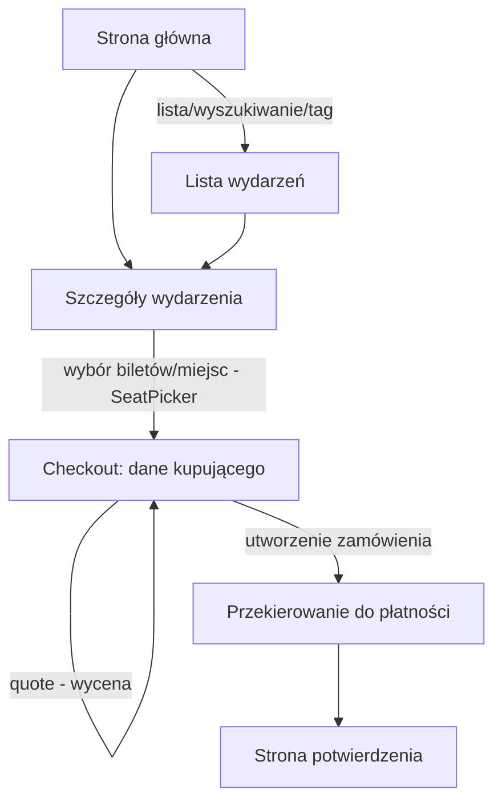

# Aplikacja webowa dla użytkownika końcowego

**Uwaga:** nazwa repozytorium (TurnupApp) sugeruje aplikację mobilną, ale faktycznie jest to responsywna **aplikacja webowa** (React 19 + TanStack Start, SSR) — nie ma natywnego wrappera (Capacitor/Expo) ani konfiguracji PWA. Działa w przeglądarce, komunikuje się z TurnupCms przez REST API opisane w [rest_api.md](../technical/rest_api.md).

## Cel funkcjonalny

Sklep biletowy dla klienta końcowego: przegląd wydarzeń, zakup biletów (z wyborem miejsc lub bez), odnajdywanie zakupionych biletów bez logowania, zarządzanie kontem i historią zamówień.

## Role użytkowników: CMS vs Aplikacja webowa

| | TurnupCms (panel) | TurnupApp (storefront) |
|---|---|---|
| Użytkownik | Administrator / właściciel wydarzenia | Kupujący bilet (gość lub zalogowany) |
| Dostęp | Filament, guard `admins`, RBAC per moduł | Publiczny + sesja Sanctum dla konta |
| Zakres | Tworzenie wydarzeń, grup biletów, kodów rabatowych, raporty sprzedaży | Przegląd, zakup, odnajdywanie biletów, konto |

## Przepływ 1: Przeglądanie → Szczegóły wydarzenia → Checkout

1. Strona główna (`/`) lub lista wydarzeń (`/wydarzenia`, z filtrem po tagu/wyszukiwaniu).
2. Szczegóły wydarzenia (`/wydarzenia/{tag}/{event}`) — opis, grupy biletów, opcjonalnie plan miejsc (komponent `SeatPicker`).
3. Checkout (`/wydarzenia/{tag}/{event}/zamowienie`) — formularz danych kupującego/adresu (react-hook-form + zod), żywa wycena (`quote`), zgoda RODO, utworzenie zamówienia → przekierowanie na `payment_url` dostawcy płatności.
4. Potwierdzenie (`/wydarzenia/{tag}/{event}/potwierdzenie`) — status zamówienia po kodzie płatności.

## Przepływ 2: Odnajdywanie biletu (bez logowania)

Trzyetapowy wizard na `/znajdz-bilet`:

1. Wybór wydarzenia + numer zamówienia → `lookup` (zawsze 200, nie zdradza czy zamówienie istnieje — poza limitem zapytań 429).
2. Kod SMS → `verify`.
3. Lista biletów z kodem QR (base64 PNG) + CTA "zapisz do konta" → `/profil`.

## Przepływ 3: Konto użytkownika

- Logowanie/rejestracja (`/logowanie`) — sesja cookie (Sanctum), bez tokenów bearer.
- Reset hasła (`/reset-password`) — **tylko przez link wysłany przez administratora**, brak samoobsługowego "zapomniałem hasła".
- Profil (`/profil`) — historia zamówień, lista biletów, edycja profilu, zmiana hasła.

## Nawigacja i treść

- Menu główne/stopka (`/menu/{main|footer}`) i strony statyczne CMS (`/strona/{slug}`) ładowane z backendu — patrz [static_pages.md](./static_pages.md).
- Przekierowania starych URL (`/redirects/lookup`) wykonywane przed błędem 404.

## Model danych na kliencie

Typy TS w `src/lib/api/types.ts` odwzorowują 1:1 zasoby API Laravel (ręcznie zweryfikowane względem kontrolerów/resource — auto-generowany snapshot OpenAPI uznano za niewiarygodny). Kluczowe różnice typowania wobec intuicji: ceny jako string, statusy jako integer, obrazy jako ścieżki względne rozwiązywane względem `API_ORIGIN`.

## Tryb standalone (deweloperski)

Gdy zmienna `VITE_API_URL` nie jest ustawiona, front działa w pełni na danych mockowych (`src/lib/api/mock.ts`) — bez backendu. Przydatne do pracy nad UI bez działającego TurnupCms.

## Podsumowanie

TurnupApp jest frontem webowym (nie natywną aplikacją mobilną) zbudowanym na React 19 + TanStack Start, obsługującym trzy główne przepływy: zakup biletu, odnajdywanie biletu bez logowania (SMS-gated) i zarządzanie kontem. Cały stan serwerowy idzie przez TanStack Query, bez własnego store'a globalnego. Pełny kontrakt API — [rest_api.md](../technical/rest_api.md); architektura obu komponentów — [architecture.md](../technical/architecture.md).
