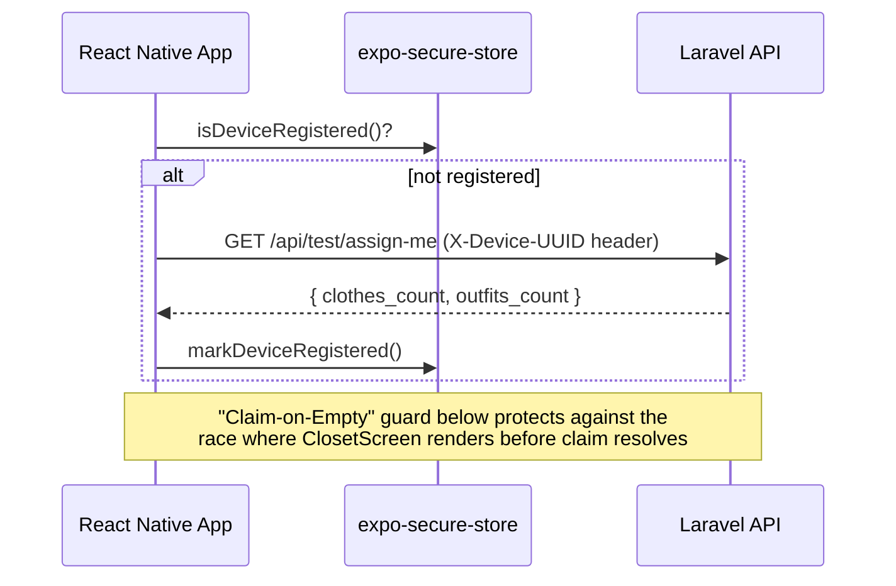
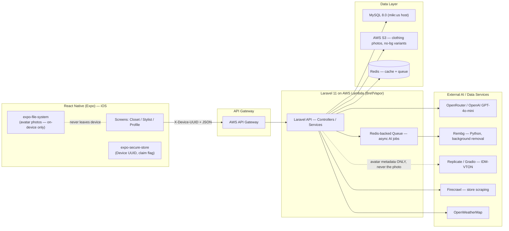
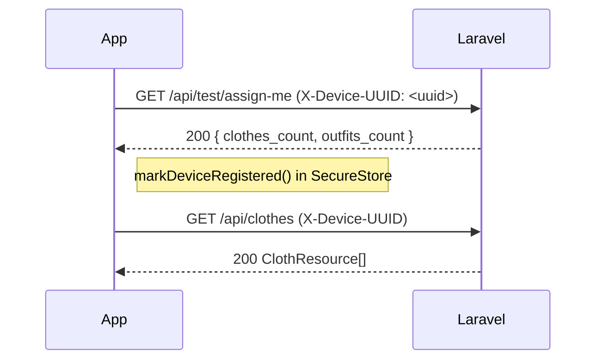

# MirrorMatch (MirrorMe) — Technical & Functional Documentation

> Source material: `MatchMe` Obsidian vault (00–18 notes, Apr–May 2026), `AiStylingService` / `RecommendationController` / mobile dev-log entries. Items not yet implemented in code are marked **[Planned]**; items confirmed from the dev log are marked **[Implemented]**. Everything else is derived architecture, marked **[Derived]** where it extrapolates beyond the source notes.

---

## 1. System Overview & Functional Specification

### 1.1 Project Purpose & Core Value Proposition

MirrorMatch (internal codename "MirrorMe", concept name "Wirtualna Szafa" / Digital Wardrobe) is a privacy-first, AI-powered digital wardrobe app. Its core value proposition is eliminating the "what do I wear" dilemma with **near-zero data-entry effort**: a user photographs a garment once, AI strips the background and tags it, and from that point the app proposes outfits driven by weather, occasion, and the user's colour/body profile.

Two design constraints shape every downstream architecture decision:

1. **Minimal input effort** — photo-scan or barcode/URL scrape, not manual form-filling, is the default item-acquisition path.
2. **Hybrid privacy model** — biometric/silhouette data for the Virtual Try-On avatar never leaves the device; only clothing photos (background removed) and style metadata are sent to the backend. See §2.3 and §5.3.

### 1.2 Functional Module Breakdown

#### Wardrobe Module
- **Acquisition:** photo capture → AI background removal (Rembg) → automatic tagging (category, dominant colour, brand if legible, size if legible, material composition). URL/barcode scraping is a v1.0 stretch goal, not MVP.
- **Item lifecycle status:** `ClothStatus` enum — `pending` (awaiting async AI processing), `ready` (wearable), `dirty` (needs laundry) **[Implemented — PHP 8.3 backed enum, `app/Enums/ClothStatus.php`]**. Column is `VARCHAR`, not a MySQL `ENUM`, specifically so new cases (`lent`, `sold`) can be added without a DDL migration — see §3.1.
- **Manual management:** category edit, tag edit, delete, mark dirty/clean.

#### AI Stylist & Recommendation Module
- **Inputs:** the user's `ready`-status wardrobe (with `category` eager-loaded), optional weather (`lat`/`lon` → `WeatherService` → OpenWeatherMap), and `occasion` (defaults to `casual` client-side; no occasion selector shipped yet — see Backlog).
- **Engine:** `AiStylingService` **[Implemented]** — sends a two-message payload to OpenRouter/OpenAI (GPT-4o-mini): a stable system prompt (deliberately kept >1024 tokens to qualify for provider-side prefix caching) + a variable user payload (wardrobe JSON + weather + occasion). Enforces `json_schema` with `strict: true`, so the model can only return `{"outfit_ids": [...], "stylist_comment": "..."}`.
- **Anti-hallucination guard:** `parseResult()` filters `outfit_ids` down to IDs that actually exist in *that user's* wardrobe — closes off cross-tenant ID leakage from a hallucinating model.
- **Failure mode:** any transport/HTTP/auth error is logged via `Log::warning` and the service returns `null` — the controller degrades gracefully (422 on empty wardrobe, 503 on AI unavailable) rather than crashing the request.
- **Feedback loop [Planned]:** 👍/👎 on each proposal writes into `user_profiles.style_tags`, updating preference weighting over time.

#### Avatar & Virtual Try-On (VTON) Module
- **Privacy-first local processing:** the user's base/silhouette photo is captured and processed **on-device only** (see §2.3, §5.3). The backend only ever receives an anonymised numeric body-shape model (height, body-shape class) — never the original image.
- **VTON rendering [Planned]:** candidate engines are Replicate-hosted IDM-VTON or a Gradio-API equivalent. MVP scope explicitly **drops** full video-avatar generation in favour of a static garment "collage" over the stored silhouette parameters (see §1.2 MVP scope cut, §5.3).

#### Laundry & Usage Tracker
- `usage_count`, `last_worn_at` on `clothes` **[Implemented as schema design]** feed both the laundry state (`dirty`/`ready`) and a "what should I sell" signal (low-usage items surfaced to the Marketplace module).
- `usage_history` logs date, outfit, temperature, weather condition, and a mood rating per wear — this is also the training signal for the feedback loop above.

#### Marketplace & Monetization Module
- **Smart Ads:** gap analysis over the wardrobe (e.g. "5 jackets, 0 white shirts that match your base palette") drives contextual affiliate placements from partner stores.
- **Marketplace Assistant:** low-usage items get a "copy description + photos" export flow targeting Vinted/OLX-style listings (commission or premium-listing fee model).
- **Premium subscription:** advanced trend analytics + unlimited avatar-styling generations (AI compute cost is the gating resource — see §1.3 cost model).

### 1.3 User Journeys & State Diagrams

#### Guest Mode → Device Handshake (critical path, see §2.2 and §4.1 for protocol detail)



**Claim-on-Empty handshake [Implemented, fixed 2026-05-13].** The naive version of this flow was fire-and-forget: `ensureDeviceRegistered()` ran in `App.tsx`'s mount `useEffect` without blocking UI, so `ClosetScreen` could render and fetch wardrobe data *before* the claim resolved — and because the SecureStore flag was set optimistically, a later cold start would never retry even though the claim had never actually populated data. Fix: `ClosetScreen` now holds a `claimAttempted` `useRef<boolean>` (not `useState` — a ref survives `useCallback` dependency changes and causes no re-render) and, on first load with an empty wardrobe and the "All" filter active, synchronously calls `claimTestData()` then re-fetches — all under a single spinner labelled "Łączenie z profilem testowym…" ("Connecting to test profile…") so the user never sees an empty-state flash.

#### Onboarding (first run)

1. Splash screen.
2. Three-slide welcome carousel ("Your wardrobe in your pocket", "AI stylist on call", "Virtual fitting room") → **[Start without an account]** CTA.
3. Empty-closet home screen: central `[+]` add-item button with tooltip; secondary banner prompting avatar creation.

#### Adding a garment

1. Tap `[+]`.
2. Choose **Take photo** or **Scan code** (barcode/URL scrape is v1.0, not MVP).
3. AI strips background (Rembg).
4. Preview → **Save to wardrobe**.

#### Retention trigger → account creation

After **10 items added**, or on attempting to use the Avatar from a second device, the app prompts: "Secure your wardrobe — create an account to sync across devices." This is the only forced-registration gate; everything before it runs anonymously on the device UUID.

#### Contextual "Outfit Dilemma" nudge [Planned]

Event-driven (not menu-driven) UX: if a user spends >60s inside `OutfitBuilder` without saving a set, a tooltip offers a 3-question micro-survey; the answers + wardrobe item IDs go to GPT-4o-mini, which returns 3 "right now" proposals.

---

## 2. Technical Architecture & Domain Design

### 2.1 High-Level Architecture



**Why AWS Lambda + mikr.us, not a single managed cloud.** This is a deliberate cost trade-off **[Derived from `18_Dev_Log` + `Index.md` cost figures]**: Lambda-via-Bref gives near-zero idle cost for a pre-revenue MVP, while a persistent, cheap MySQL host (mikr.us, flat ~45 PLN/month including the Apple Developer fee) avoids RDS's always-on billing. The cost of this choice is cross-network latency between a Lambda invocation (Frankfurt, `eu-central-1` typical) and a non-AWS database host — addressed in §3.2.

### 2.2 Design Patterns & Principles Applied

**Domain-Driven Design — bounded contexts.** Three contexts are visible from the implemented code and the schema design:
- **Wardrobe** (`clothes`, `categories`, `tags`, `cloth_tag`, `usage_history`) — owns garment lifecycle and laundry state.
- **Styling** (`outfits`, `outfit_clothes`, `style_profiles`, `AiStylingService`) — owns recommendation generation; consumes Wardrobe read-only.
- **Device Identity** (the `X-Device-UUID` middleware group, `test/assign-me`) — owns anonymous-to-registered identity; every other context depends on it, it depends on nothing else.

**Repository & Action/Service pattern.** `AiStylingService` is a plain service class (not a repository) encapsulating a single external-integration responsibility (prompt construction, call, strict-schema parse, anti-hallucination filter) behind a method the controller calls once. `RecommendationController` stays thin: validate (`RecommendationRequest`), fetch weather (optional), fetch ready wardrobe, delegate, shape the response.

**Handshake & Claim Protocol ("Device Sync" / "Claim-on-Empty").** See §1.3 and §4.1. The protocol's defining property: claim is **idempotent and re-triggerable from the client** whenever the client observes a state inconsistent with "claim already happened" (empty wardrobe + unfiltered view), rather than relying solely on a persisted flag. The in-memory `claimAttempted` ref is intentionally *not* durable across app restarts — the backlog item explicitly flags this as the next hardening step (persist with a TTL, or reset on pull-to-refresh) if the backend ever resets a tester's data.

**Asynchronous background jobs.** Redis-backed queue fronts the Rembg background-removal step and is the intended home for future VTON generation jobs (status-polled or push-notified — see §2.3 error policy for the user-facing side of this).

**Native PHP enum over MySQL `ENUM` — a schema-level design principle, not just a `clothes.status` detail.** Recorded explicitly in the 2026-05-17 refactor: a MySQL `ENUM` column requires a `ALTER TABLE` for every new state; a `VARCHAR` column cast through a PHP 8.1+ backed enum (`ClothStatus::class` in `casts()`) gets the same type-safety at the application boundary with zero DDL cost to add a case. This is the house style for any future state-machine column (e.g. a hypothetical `sales_tracking.status`).

### 2.3 Privacy & Security Architecture

**The hard rule:** the base/silhouette photo used for the Avatar **never leaves the device**. This is not a configuration choice — it is encoded in the client architecture:

- Avatar photos are written via `expo-file-system` into the app's `Documents` sandbox (e.g. `file:///var/mobile/Containers/.../avatar_01.jpg`) and the local path is persisted in `AsyncStorage`/SQLite, not in any synced table.
- Only the *parameters* derived from that photo (height, body-shape class such as "hourglass") are ever sent to Laravel — as plain JSON fields, never as a file upload.
- Clothing photos follow the opposite path: captured locally, background-removed, then **uploaded** to Laravel → S3; the phone keeps only the resulting S3 URL, not the original.

**Anonymised API payloads.** The device-identity layer uses `X-Device-UUID` as a bearer-equivalent header for anonymous (guest) sessions; no PII is required for image-processing or styling calls. `expo-secure-store` holds the UUID and the one-shot "already claimed" flag — Keychain/Keystore-backed, not plain `AsyncStorage`, specifically because this value functions as a credential.

**Data protection baseline [Planned, from `03_Privacy_Protocol`]:** end-to-end encryption for the clothing-photo gallery; GDPR ("RODO") alignment for any biometric-adjacent data, which in practice means the architecture above (never transmitting the raw body photo) *is* the primary GDPR control, not a bolt-on policy.

---

## 3. Database & Storage Specification

### 3.1 Relational Database Schema (MySQL 8.0)

```mermaid
erDiagram
    users ||--o{ clothes : owns
    users ||--|| user_profiles : has
    users ||--o{ user_measurements : has_history_of
    users ||--o{ outfits : creates
    users ||--o{ usage_history : logs
    categories ||--o{ clothes : classifies
    categories ||--o{ categories : parent_of
    clothes ||--o{ cloth_tag : tagged_via
    tags ||--o{ cloth_tag : applied_via
    outfits ||--o{ outfit_clothes : composed_of
    clothes ||--o{ outfit_clothes : included_in
    outfits ||--o{ usage_history : worn_as
    clothes ||--o{ sales_tracking : listed_as

    users {
        bigint id PK
        string email
        string password_hash
    }
    user_profiles {
        bigint id PK
        bigint user_id FK
        string color_type "e.g. Autumn (12-type system)"
        string body_type "hourglass, pear, apple..."
        json style_tags
    }
    user_measurements {
        bigint id PK
        bigint user_id FK
        int height
        int weight
        int waist
        int chest
        int hips
        date measured_at
    }
    categories {
        bigint id PK
        string name
        bigint parent_id FK "self-referential"
    }
    clothes {
        bigint id PK
        bigint user_id FK
        bigint category_id FK
        string brand "nullable, from logo detection"
        string size "nullable, from label OCR"
        string color_hex
        json material_composition "[{name, percentage}]"
        string image_front_url
        string image_back_url
        string image_no_bg_url
        string source_url "nullable, scraped origin"
        string ean_code "nullable, barcode"
        string status "VARCHAR, PHP-enum-backed: pending|ready|dirty"
        datetime last_worn_at
        int usage_count
    }
    tags { bigint id PK; string name }
    cloth_tag { bigint cloth_id FK; bigint tag_id FK }
    outfits {
        bigint id PK
        bigint user_id FK
        string name
        string occasion
        json occasion_tags
        int min_temp
        int max_temp
        bool is_favorite
    }
    outfit_clothes { bigint outfit_id FK; bigint cloth_id FK }
    usage_history {
        bigint id PK
        bigint user_id FK
        bigint outfit_id FK
        date worn_on
        int temp
        string weather_condition
        int mood_rating
    }
    sales_tracking {
        bigint id PK
        bigint cloth_id FK
        string platform "e.g. vinted"
        decimal price
        string status
    }
    scraped_items {
        bigint id PK
        string store_name
        decimal price
        string url
        string image_url
        bigint category_match FK
    }
```

**Status column design.** `clothes.status` is `VARCHAR`, cast via `ClothStatus` (`pending|ready|dirty`), not a native MySQL `ENUM` — see §2.2 for the rationale (zero-DDL case additions). The 2026-05-17 migration performed a two-step data fix: `UPDATE clothes SET status = 'ready' WHERE status = 'clean'` (renaming a legacy value) before changing the column default to `'ready'`.

**JSON metadata columns** carry data that is either genuinely variable-shape (`material_composition`: a variable-length array of `{name, percentage}` pairs) or read far more often as a whole blob than queried by sub-field (`style_tags`, `occasion_tags`) — both are legitimate uses of MySQL JSON columns rather than normalized child tables, trading query-ability on individual sub-fields for schema flexibility during an MVP phase where the tag vocabulary is still moving.

**Known schema debt [flagged in dev log, 2026-05-17]:** `clothes.is_dirty` (boolean) is now partially redundant with `ClothStatus::Dirty`. Planned resolution: remove the boolean column in a future migration, or replace it with a virtual accessor derived from `status`.

### 3.2 Indexing, Latency, and Query Optimization

The load-bearing constraint here is **AWS Lambda (Frankfurt) talking to MySQL on mikr.us (not AWS-colocated)** — every cold Lambda invocation pays both a fresh TCP+TLS handshake to a non-VPC-peered host and the baseline network RTT to mikr.us's datacenter.

- **Timeout policy [Implemented, `14_Agent_Roles.md` error policy]:** if the DB read exceeds ~5s, the client shows a branded loader ("Your wardrobe is settling in..."); past 10s, the request is aborted and the user is asked to refresh. This is a UX compensation for a latency budget the team cannot fully control at the infrastructure layer.
- **Connection-pooling implication [Derived]:** because Lambda cannot hold a long-lived outbound connection pool across invocations the way a long-running server process can, each cold invocation effectively re-pays the connection-setup cost. Mitigations in this stack's class of problem: keep Lambda warm via scheduled pings for latency-sensitive endpoints, and/or front MySQL with Redis for anything read far more often than it's written (wardrobe listing, category tree) rather than relying on connection reuse.
- **Eager loading is mandatory, not optional, in this codebase.** `AiStylingService` explicitly requires the `Cloth` collection to arrive with `category` already eager-loaded — avoiding an N+1 query storm is directly load-bearing for staying under the 5s soft timeout above, since every avoided round-trip to mikr.us is a full network RTT saved.
- **Caching with Redis:** recommendation results are an explicit backlog item — cache per `(user, weather-bucket, occasion)` for ~15 minutes to avoid re-hitting OpenAI on every pull-to-refresh; the `useWeather` hook backlog similarly flags a 10-minute client-side TTL to avoid redundant location-permission round-trips within one session.
- **Indexing guidance [Derived, not yet confirmed against live migrations]:** `clothes(user_id, status)` composite index (every wardrobe listing and the recommendation query both filter by both columns), `outfit_clothes(outfit_id)` and `(cloth_id)` as the join-table's two natural lookup directions, `usage_history(user_id, worn_on)` for the laundry/usage-analytics queries.

### 3.3 File Storage Topology

- **Clothing photos:** captured on-device → background-removed (Rembg) → uploaded to Laravel → persisted to **AWS S3**, with the mobile client retaining only the resulting URL (`image_front_url`, `image_back_url`, `image_no_bg_url`).
- **Spatie Media Library [per `Index.md` stack summary]** is the intended variant-generation layer on the Laravel side — standard practice for this stack is deriving thumbnail/preview/full-size conversions on upload and serving them via pre-signed S3 URLs so the bucket itself stays private.
- **Avatar/silhouette photos are explicitly excluded from S3** — see §2.3. There is no server-side storage path for them by design; they exist only inside the app's `expo-file-system` `Documents` sandbox.

---

## 4. API & Integration Contract (REST & Marketplace)

### 4.1 Global Headers & Device Authentication

| Header | Purpose | Notes |
|---|---|---|
| `X-Device-UUID` | Anonymous device identity | Generated client-side, persisted in `expo-secure-store`; functions as the guest-mode bearer-equivalent. Middleware group name in the Laravel routes: `IdentifyDeviceUuid`. |
| `Authorization: Bearer <token>` | Registered-user identity | Issued after the retention-trigger registration flow (§1.3); supersedes device-UUID-only auth once present. |

**Guest-to-User handshake.**



`claimTestData()` always calls `GET /api/test/assign-me` and returns the full `AssignMeResponse` (`clothes_count`, `outfits_count`); `ensureDeviceRegistered()` is a thin wrapper that delegates to it the first time a device is seen. See §1.3/§2.2 for why the client re-triggers this call even when the local "already claimed" flag is set.

### 4.2 Core REST API Endpoint Specifications

#### `GET /api/test/assign-me` — Device Handshake / Guest Claim **[Implemented]**
Assigns (or re-confirms assignment of) a test/guest profile's data to the calling `X-Device-UUID`.

```json
// 200 Response
{
  "clothes_count": 12,
  "outfits_count": 3
}
```

#### `GET /api/clothes` & `POST /api/clothes` — Closet CRUD **[Implemented]**
`POST` accepts a captured photo, triggers the background-removal pipeline, and explicitly sets `status = ClothStatus::Ready` on creation (no longer relying on the DB column default — fixed in the 2026-05-17 refactor).

```json
// ClothResource shape (GET /api/clothes response item)
{
  "id": 42,
  "category_id": 3,
  "brand": "Uniqlo",
  "size": "M",
  "color_hex": "#1A2B3C",
  "material_composition": [{"name": "cotton", "percentage": 100}],
  "image_no_bg_url": "https://s3.../clothes/42_no_bg.png",
  "status": "ready",
  "status_label": "Gotowe",
  "usage_count": 4,
  "last_worn_at": "2026-05-10"
}
```

#### `GET /api/weather` — Weather Proxy **[Implemented]**
Privacy-protecting proxy: the mobile client's `useWeather` hook requests device location permission, resolves coordinates via `getCurrentPositionAsync`, and sends only `lat`/`lon` query params to this endpoint — raw coordinates are never persisted in component state, only forwarded. Backend proxies to OpenWeatherMap so the provider API key never ships inside the mobile bundle.

```
GET /api/weather?lat=52.2297&lon=21.0122
```

#### `POST /api/recommendations` — AI Styling **[Implemented]**
Validated by `RecommendationRequest` (`lat`, `lon`, `occasion`). Weather lookup is optional — missing coordinates do not block the request. Pulls the caller's `status = ready` wardrobe with `category` eager-loaded, delegates to `AiStylingService`.

```json
// Request
{ "lat": 52.2297, "lon": 21.0122, "occasion": "wedding" }

// 200 Response
{
  "data": {
    "outfit_ids": [12, 45, 50],
    "stylist_comment": "A warm, autumn-toned set that reads smart-casual for a daytime wedding.",
    "weather": { "temp": 20, "condition": "clear" },
    "clothes": [ /* full ClothResource[] for the chosen IDs */ ]
  }
}
```

| Status | Condition |
|---|---|
| `200` | Recommendation produced |
| `422` | Wardrobe is empty |
| `503` | AI provider unavailable (`AiStylingService` returned `null`) |

**Strict JSON Schema enforcement.** `AiStylingService` calls OpenRouter with `response_format: {"type": "json_schema", "json_schema": {..., "strict": true}}`, so the model is structurally constrained to emit exactly `{"outfit_ids": [...], "stylist_comment": "..."}` — no markdown fences, no extra prose, no missing keys. `parseResult()` then re-validates `outfit_ids` against the caller's own wardrobe ID set before returning, closing the hallucination/cross-tenant-leak risk a schema constraint alone cannot close.

#### `POST /api/outfits` — Outfit creation **[Implemented]**
```json
// OutfitPayload (note: lat/lon, not latitude/longitude — a client-side bug
// fixed 2026-05-13 where OutfitBuilderScreen originally sent the wrong field names)
{
  "cloth_ids": [12, 45, 50],
  "lat": 52.2297,
  "lon": 21.0122,
  "name": "Wedding — autumn palette"
}
```
Response (`OutfitResource`): `name`, `occasion`, `min_temp`, `max_temp`, `is_favorite`, `clothes[]`.

### 4.3 External Integrations

#### Firecrawl — Markdown extraction & structuring **[Planned for scraping, prompt already drafted]**
Firecrawl converts a merchant product page into Markdown; GPT-4o-mini structures it with a strict-schema prompt:
```json
{ "brand": "...", "material": "...", "category": "...", "color_hex": "..." }
```

#### OpenRouter / OpenAI — styling & vision prompts **[Implemented: styling; photo-classification prompt drafted]**
Two production-shaped prompts exist in the source notes:
1. **Outfit Generator** system prompt — takes occasion, temperature/condition, colour type, style tags; returns `{"outfit_ids": [...], "stylist_comment": "..."}`.
2. **Photo classifier** system prompt (vision) — an 8-step chain-of-thought spec for a single garment photo: identify garment class (from a fixed 6-category enum: `tops|bottoms|shoes|outerwear|dresses|accessories`), dominant colour (hex, `null` only if genuinely indeterminate), brand (logo OCR, `null` if not fully legible — explicitly forbidden to guess from style alone), size (label OCR only, never inferred from proportions), material composition (label OCR preferred, visual inference as fallback, `[]` only for accessories where material truly can't be guessed), a ≤15-word English description, and a 0–100 confidence score. Output contract: valid JSON only, no markdown fences, no extra fields, `null` (not empty string) for genuinely absent values.

#### Marketplace Export — Vinted/OLX listing structure **[Planned]**
"Copy description + photos" flow: pre-fills a listing draft (category, brand, size, material, price suggestion from `scraped_items.category_match` comparables) that the user pastes into the target marketplace — MVP scope is explicitly **assisted manual listing**, not a programmatic Vinted API integration.

---

## 5. Mobile Client Architecture (React Native / Expo)

### 5.1 Directory Structure & Navigation Hierarchy

Confirmed screens and navigation entries from the dev log (`App.tsx`'s `RootStackParamList` / `Stack.Navigator`):

```
src/
├── screens/
│   ├── ClosetScreen.tsx        # home: wardrobe grid, category filter, claim-on-empty guard
│   ├── OutfitBuilderScreen.tsx # 3-column multi-select grid, Weather Tag pill, Save CTA
│   ├── StylistScreen.tsx       # saved outfits list, horizontal cloth-thumbnail scroll
│   └── EditClothScreen.tsx     # re-used directly from CameraScreen (CropScreen was rolled back)
├── hooks/
│   └── useWeather.ts           # location permission → coords → GET /weather → temp
├── services/
│   ├── api.ts                  # apiGet/apiPost, X-Device-UUID header, ensureDeviceRegistered, claimTestData
│   ├── deviceId.ts             # isDeviceRegistered() / markDeviceRegistered() via SecureStore
│   └── outfitsService.ts       # saveOutfit(), getOutfits()
└── App.tsx                     # navigator root, mount-time ensureDeviceRegistered()
```

`RootStackParamList` entries confirmed: `OutfitBuilder: undefined`, `Stylist: undefined`. `ClosetScreen`'s header exposes a "Stylizacje" button routing to `StylistScreen`.

**Rolled-back path [reverted 2026-05-11]:** a separate `CropScreen.tsx` built on `expo-image-manipulator` was removed; `CameraScreen` now returns directly into `EditClothScreen`, reusing the original capture rather than inserting a manual crop step. Treat this as a closed decision, not an open option — re-introducing a crop step would need a fresh justification.

### 5.2 State Management & Custom Hooks

- **`useWeather`** — owns the location-permission request and `getCurrentPositionAsync` call; forwards `lat`/`lon` to `GET /weather` and returns only the resolved temperature/condition to the component. Deliberately does **not** keep raw coordinates in component state (privacy-by-construction, not just policy — see §2.3). Backlog: a 10-minute client-side TTL cache to avoid re-requesting location on every re-render within one session.
- **`outfitsService.saveOutfit(payload)`** — `POST /outfits` via `apiPost`; `OutfitBuilderScreen`'s save button re-resolves fresh coordinates at the moment of saving rather than reusing a stale `useWeather` value, since weather can be minutes stale by the time the user finishes building a set.
- **No global state library detected** (no Redux/Zustand/Jotai reference in the dev log) — state is local-to-screen plus the two persistence layers (`SecureStore` for identity, `AsyncStorage`/SQLite for the local avatar-path index). This is consistent with an MVP-scope app with a shallow screen graph; revisit only if cross-screen state sharing becomes a real pain point.
- **`useStylist` [named in the task brief, not yet present in the dev log]** — the natural next hook once `StylistScreen` needs filtering/pagination (both already flagged as backlog items — see §1.2 Laundry/Usage and the dev-log backlog entries for 2026-05-13).

### 5.3 Offline-first Handling & Image Caching

- **Offline wardrobe access [Planned, `14_Agent_Roles.md` error policy]:** when the device has no connectivity, `ClosetScreen` is specified to read from local cache (`AsyncStorage`) rather than failing; new items added offline are specified to queue locally and sync once connectivity returns ("Queue on Mobile" — not yet confirmed as implemented against a concrete queuing mechanism in the dev log, so treat the *mechanism* as a design target, not a shipped feature).
- **Avatar image "caching" is actually permanent local storage, not a cache** — see §2.3/§3.3. There is no eviction policy to design here because there is no server copy to fall back to; losing the local file means the user re-captures their avatar base photo.
- **Clothing-photo display** uses the S3-hosted `image_no_bg_url` directly in `<Image>` — standard RN image-cache behaviour (OS-level HTTP cache) applies; no custom cache layer is called out in the source notes.
- **VTON generation latency UX [Planned]:** because try-on rendering can take longer than a user will wait on-screen, the specified pattern is "fire the job, notify on completion" (push notification or background status flag) rather than a blocking spinner — mirrors the existing `AiStylingService` graceful-degradation philosophy (§2.2) applied to a slower, queue-backed job instead of a synchronous API call.

---

## Appendix A — MVP Scope Cuts (explicit, not implicit)

Recorded directly in `05_MVP_Roadmap.md` — treat these as a **decision log**, not a TODO list to silently reverse:

1. Video-avatar generation → replaced by a static garment collage over stored silhouette parameters.
2. Barcode/URL-scrape auto-import → deferred to v1.0; MVP ships photo-capture only.
3. Complex ad-serving system → deferred; only affiliate-style Smart Ads ship in MVP.

## Appendix B — Design System Reference

| Role | Color | Hex | Usage |
|---|---|---|---|
| Primary | Pitch Black | `#000000` | Headings, primary CTAs |
| Background | Snow White | `#FFFFFF` | App background |
| Surface | Soft Gray | `#F5F5F7` | Cards, section backgrounds, inputs |
| Accent | Gold | `#AF944F` | Premium elements, Avatar icon, favourites |
| Error | Vinted Red | `#FF3B30` | Delete, errors, sale alerts |
| Success | Clean Green | `#34C759` | Item-added confirmation |

Typography: iOS system font (San Francisco), Bold/Semibold headings, Regular body. Components: `12px` border-radius (or `50%` for circular icon buttons); clothing cards use a `1px solid #E5E5E5` border instead of a shadow.

## Appendix C — Open Items Carried From the Dev Log

- `AiStylingService::parseResult()` has no unit test coverage yet.
- No per-`(user, weather, occasion)` caching on `/recommendations` yet — every pull-to-refresh re-hits OpenAI.
- `StylistScreen` has no pagination; will need cursor-based paging once outfit counts grow.
- `occasion` is not yet user-selectable in the UI (hardcoded `"casual"` client-side default) — `StylistScreen`/`OutfitBuilderScreen` need an occasion selector before `/recommendations`' occasion parameter is genuinely useful.
- `is_favorite` on outfits has no toggle UI yet (display-only).
- `clothes.is_dirty` boolean is redundant with `ClothStatus::Dirty` — candidate for removal or conversion to a virtual accessor.
- No `Rule::enum(ClothStatus::class)` validation yet on any endpoint that would accept a status value from the client.
- `claimAttempted` is in-memory only (resets on app restart) — no durable TTL-based guard yet against a backend-side data reset for a tester account.
