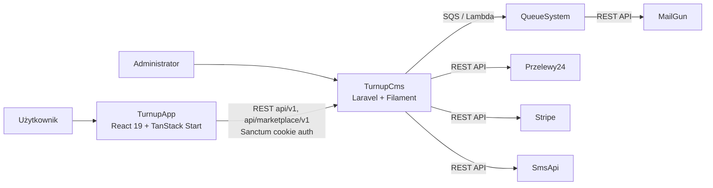

# Architektura systemu

System składa się z dwóch głównych komponentów oraz jednego serwisu pomocniczego:

- **TurnupCms** — monolit Laravel: logika biznesowa, panel administracyjny (Filament), REST API dla klienta.
- **TurnupApp** — aplikacja webowa (storefront) dla użytkownika końcowego. **Uwaga:** mimo nazwy repozytorium nie jest to natywna aplikacja mobilna (brak Capacitora/Expo) — to React 19 + TanStack Start (SSR) + Vite, czyli responsywna aplikacja webowa konsumująca REST API TurnupCms.
- **QueueSystem** — osobny mikroserwis Laravel/Serverless (AWS Lambda + SQS) do zadań asynchronicznych (maile, SMS) — opisany w [outside_integrations.md](./outside_integrations.md).

## TurnupCms — warstwy i wzorce

Projekt to **rdzeń legacy stopniowo modernizowany** — stare tabele (int PK, `0000-00-00` defaulty, kontrolery `routes/web.php`) współistnieją z nowym, typowanym layerem (enumy PHP, DTO, Filament, `api/marketplace/v1`). Ten fakt wyjaśnia niejednorodność wzorców w kodzie.

Przepływ: `Controller` (tylko routing + walidacja) → `Service` (logika biznesowa) → `Repository` (zapytania) → `Model` (Eloquent).

| Wzorzec | Gdzie w kodzie |
|---|---|
| **Service layer** | `app/Services/Orders/OrderService.php`, `SeatAvailabilityService`, `SeatHoldService`, `TicketAvailabilityService`, `ValidateTicketPurchaseService`; `app/Services/Payments/PaymentService.php` + `Przelewy24Service.php`, `StripeService.php` |
| **Repository** | `app/Repositories/BaseRepository.php` (generyczny CRUD) → `EventRepository`, `OrderRepository`, `TicketRepository`, `AdminRepository`, `Languages/*Repository` |
| **DTO / Value Object** | `app/DTOs/OrderData.php`, `OrderResult.php`, `TicketsToOrderRequestDto.php`, `PaymentProvider/P24/P24WebhookResponseDTO.php`, `Stripe/StripeWebhookResponseDTO.php` (webhooki normalizowane do typowanych DTO przed przekazaniem do serwisu); `app/ValueObjects/StatisticsDateRange.php` |
| **Enumy natywne PHP** | `app/Enums/Statuses/{EventStatus,PaymentStatus,TicketStatus,TicketGroupStatus,SeatInEventStatusEnum}.php`, `Currency.php`, `DiscountTypesEnum.php`, `Permissions/{ModuleEnum,PermissionEnum,SpecialPermissionEnum}.php` — statusy w DB są legacy int, enum dodaje typowanie |
| **Observery** | `app/Observers/{EventObserver,PaymentObserver,TicketObserver,ContentPageObserver,LangKeyObserver,TagObserver}.php` — side-effecty cyklu życia modelu poza kontrolerem |
| **Eventy/Listenery** | `app/Events/OrderPaid.php` → `app/Listeners/SendTicketsEmail.php` |
| **Jobs/Queue** | `app/Jobs/CleanupExpiredOrders.php` (zwalnia wygasłe nieopłacone rezerwacje/miejsca), `RecordSeoSlugChangeRedirects.php`, `SendMailingCampaignJob.php`. Driver kolejki: `database` (brak Redis w tym środowisku) |
| **Policies (RBAC)** | `app/Policies/{AdminPolicy,EventPolicy,RolePolicy,SeatSchemePolicy,SeoSettingPolicy,TagPolicy,UserPolicy,RedirectPolicy,ContentPagePolicy}.php`, trait `Concerns/ChecksModulePermissions.php` — oparte na enumach modułów/uprawnień |
| **Panel admina = Filament** | `app/Filament/Resources/{Admins,Categories,ContentPages,Events,LanguageCountries,Languages,MailingCampaigns,Menus,PaymentModules,Payments,Roles,SeatSchemes,Tags,Users}` — nowy panel budowany na Filament PHP, równolegle do starszych kontrolerów `app/Http/Controllers/Admin` |
| **Form Requests / API Resources** | `app/Http/Requests/` (walidacja), `app/Http/Resources/` (serializacja JSON dla REST API) |

### Trzy niezależne konteksty uwierzytelniania

1. **Sanctum SPA (cookie)** — `api/v1/*`, guard `web`, używany przez TurnupApp.
2. **Admins guard** — panel Filament.
3. **`async-auth` middleware** — legacy, pojedynczy endpoint `routes/admin_api.php` dla starego async UI admina.

### i18n

Tłumaczenia są **danymi w bazie**, nie plikami `lang/*.php` — edytowalne z panelu (`langs`, `langs_keys`, `langs_translates`, `langs_groups`, `langs_countries`). Obsługa przez `app/Services/Languages/I18nService.php` + repozytoria + warstwa cache (`Languages/{LanguageGroupsCacheService,LanguageKeysCacheService,LanguageTranslatesCacheService,LanguagesCacheService}.php`) — tłumaczenia są hot-path na każdym request, więc są cachowane. Cache store: `database` (brak Redis).

### Testy

PHPUnit, 107 plików testowych: `tests/Unit/{Enums,Models,Rules,Services}`, `tests/Feature/{Order,Policies,Filament,Seeders,Api,Jobs,Services}`. Najlepiej pokryte: **przepływ zamówienia (checkout)** i **autoryzacja panelu (Policies/Filament)**.

## TurnupApp — architektura

- **Stack:** React 19 + TanStack Start (SSR na Vite 8) + TanStack Router (routing plikowy) + TanStack Query v5 (cały stan serwerowy — brak Redux/Zustand). UI: Radix + shadcn-style komponenty, Tailwind v4. Formularze: `react-hook-form` + `zod`.
- **Struktura:** routing plikowy w `src/routes/` (segmenty po polsku: `logowanie.tsx`, `profil.tsx`, `znajdz-bilet.tsx`, `wydarzenia.*`), wspólna warstwa API w `src/lib/api/` (`client.ts`, `endpoints.ts`, `queries.ts`, `types.ts`, `mock.ts`), komponenty generyczne `src/components/ui/`, komponenty domenowe `src/components/turnup/` (`SeatPicker`, `EventCard`, `SearchModal`, `TopBar`, `SiteFooter`, `LocationMap`).
- **Tryb standalone:** gdy `VITE_API_URL` nie jest ustawione, `API_ENABLED=false` i wszystkie endpointy zwracają dane mockowe z `src/lib/api/mock.ts` — front działa bez backendu.
- **Build/deploy:** Vite 8 + `nitro` (beta) jako runtime TanStack Start → aplikacja SSR (serwer Node), nie statyczny SPA. Brak konfiguracji PWA (manifest to tylko standardowa favicon).

## Podsumowanie

System jest podzielony na backend-monolit (Laravel, w trakcie migracji legacy → Filament/DTO/enum) i webowy storefront (React/TanStack Start SSR), połączone REST API z uwierzytelnianiem sesyjnym Sanctum. Asynchroniczne zadania (maile, SMS) wyniesione do osobnego mikroserwisu serverless. Nazwa "marketplace" w kodzie backendu to **konwencja nazewnicza nowej wersji API**, nie integracja z zewnętrzną platformą — patrz [REST API](./rest_api.md).
