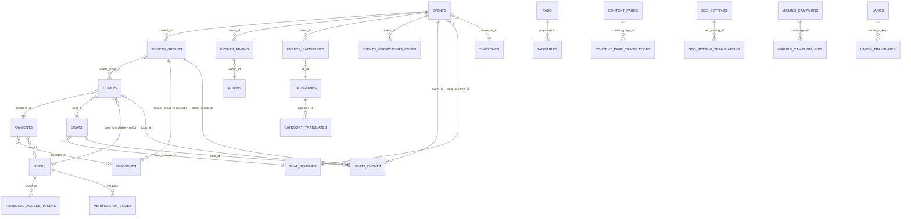

# Struktura bazy danych

Poniżej encje core domeny biletowej/sprzedażowej oraz te, które nie są jeszcze opisane w dokumentacji funkcjonalnej (`docs/functional/*`), a mają znaczenie techniczne.

## Encje nieopisane w dokumentacji funkcjonalnej

- `currency_pricings` — ceny per waluta wydarzenia.
- `verification_codes` — kody weryfikacyjne użytkownika (np. reset hasła, weryfikacja e-maila). **Uwaga:** to inna encja niż `events_verificators_codes` (kody weryfikatorów biletów na wejściu, opisane w [events.md](../functional/events.md)) — dwa niezależne pojęcia "kodu weryfikacyjnego" w systemie, łatwe do pomylenia.
- `tags` / `taggables` — polimorficzne tagowanie (nowszy mechanizm, równoległy do `categories`).
- `mailing_campaigns` / `mailing_campaign_jobs` — kampanie mailingowe i ich zadania wysyłkowe.
- `content_pages` / `content_page_translations` — strony statyczne CMS (patrz też [static_pages.md](../functional/static_pages.md)).
- `seo_settings` / `seo_setting_translations` — ustawienia SEO per język (patrz [seo.md](../functional/seo.md)).
- `system_toggles` / `system_toggle_translations` — globalne flagi funkcjonalności, tłumaczone.
- `additional_cost_settings` / `additional_cost_settings_translations` — konfiguracja dodatkowych kosztów.
- `marketing_content_settings` / `marketing_content_settings_translations` — treści marketingowe.
- `category_translates` — tłumaczenia nazw kategorii.
- `personal_access_tokens` — tokeny Sanctum (sesje API).

## Diagram relacji (ERD)

## Decyzje i workaroundy warte odnotowania

- **PK jako `integer`, nie `bigint`** w większości tabel core — pozostałość ze starszego schematu, utrzymana świadomie dla kompatybilności z istniejącymi danymi. Ryzyko: przy dużej skali możliwy overflow — do monitorowania, nie "naprawiane" bez migracji danych.
- **Legacy `0000-00-00` default daty** — migracje `events` i `events_verificators_codes` tymczasowo przełączają `sql_mode` (`SET SESSION sql_mode=''`) przy tworzeniu tabeli, aby zachować kompatybilność ze starym schematem MySQL.
- **Dwa niezależne systemy kodów weryfikacyjnych** (`verification_codes` dla użytkownika vs `events_verificators_codes` dla biletów) — przy dalszym rozwoju rozważyć ujednolicenie nazewnictwa, by uniknąć pomyłek w zespole.

## Podsumowanie

Baza łączy legacy schemat (int PK, kompatybilność ze starym MySQL) z nowszymi, w pełni tłumaczonymi tabelami konfiguracyjnymi (`*_translations` wzorzec powtarzany dla `content_pages`, `seo_settings`, `system_toggles`, `additional_cost_settings`, `marketing_content_settings`, `categories`). Wzorzec `*_translations` jest konsekwentny w całym systemie i to na nim oparty jest mechanizm wielojęzyczności opisany w [architektura systemu](./architecture.md).
